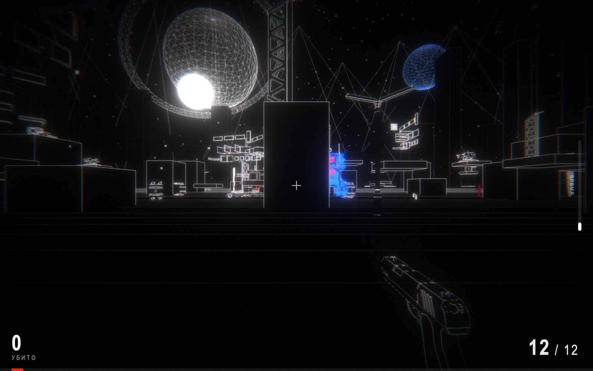

# SlowmoFPS — прототип

Шутер от первого лица на Three.js: чёрный мир, белые рёбра полигонов, никакой заливки. Время идёт, только когда идёшь ты — стоишь, и мир почти замирает.



## Что внутри

- **Время слушается движения** — без ввода `timeScale` плавно уходит к 0.05, с WASD возвращается к единице; в прыжке действует свой режим, чтобы можно было приземлиться. Слева в HUD полоска показывает текущий ход времени.
- **Мир из одних рёбер** — геометрия рисуется чёрной заливкой и белым контуром, вдаль растворяется в тумане.
- **Кинематографическая обработка**: bloom, хроматическая аберрация, виньетка, зерно, скан-линии, тряска и вспышки от попаданий — всё через `EffectComposer` собственными шейдерными проходами.
- **Оружие**: пистолет с перезарядкой и отдачей, метательные ножи, у каждого своя анимация выноса и осмотра.
- **Враги** — риггованные GLB-модели, перекрашенные в тот же вайрфрейм, с клонированием скелета через `SkeletonUtils`.
- Управление: `WASD` — движение, мышь — обзор, `Shift` — рывок, `R` — перезарядка, `Space` — прыжок.

## Запуск

Нужен любой статический сервер (модули ES не работают с `file://`):

```bash
python3 -m http.server 8777
```

и открыть `http://localhost:8777`.

## Стек

Three.js (ES-модули с CDN), чистый JS без сборщика. `js/main.js` — вся игра, ~1000 строк.

## Ассеты

Модели в `models/` — готовые, не мои: сэмплы из репозитория [glTF-Sample-Models](https://github.com/KhronosGroup/glTF-Sample-Assets) и примеров Three.js (`Soldier`, `Xbot`, `RobotExpressive`, `CesiumMan`, `BrainStem`, `RiggedFigure`), плюс модели оружия и скелетов из свободных библиотек. Лежат в репозитории ради воспроизводимости прототипа.
