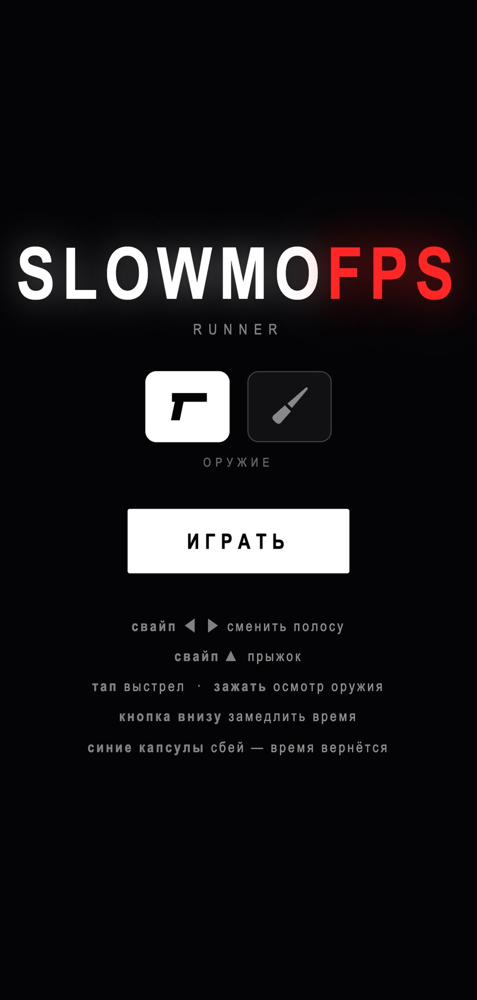
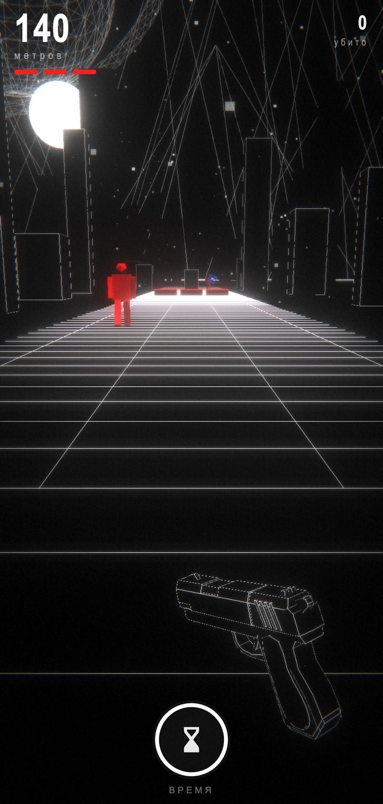

[English](README.md) · **Русский**

# SlowmoFPS Runner

Бесконечный раннер для телефона, портретный. Мир несётся на тебя по трём полосам; ты стоишь на месте и меняешь полосу, прыгаешь, стреляешь и замедляешь время, когда становится тесно. Чёрный мир, белые рёбра полигонов, красные враги — больше на экране ничего.

**▶ [Играть в браузере](https://johninwork.github.io/slowmo-fps/)** — сделано под телефон, на компьютере тоже работает.

<p align="center">
  
  
</p>

## Как играется

- **Три полосы.** Свайп влево-вправо меняет полосу, свайп вверх — прыжок. Игрок никуда не бежит — навстречу едет мир.
- **Два оружия.** Пистолет или нож, выбираются до забега; тап — атака, зажать — осмотр оружия в руке.
- **Время как ресурс.** Кнопка внизу замедляет всё вокруг. Синие капсулы на трассе возвращают шкалу, поэтому держать замедление — значит сбивать их одну за другой.
- **Враги.** Красные манекены в одной полосе и каркасный гигант, который перекрывает две и снимается с трёх попаданий — три ядра на груди и есть его здоровье.
- **Картинка та же, что в оригинале**: чёрные заливки, белые рёбра, свечение, хроматическая аберрация, зерно и скан-линии — всё пересчитано под портрет, где старые настройки уводили объектив в рыбий глаз и съедали ближний пол.

## Запуск

Нужен любой статический сервер (модули ES не работают с `file://`):

```bash
python3 -m http.server 8777
```

и открыть `http://localhost:8777`.

Прежняя арена от первого лица никуда не делась — она рядом, в `arena.html`: тот же мир, свободное движение, время, которое идёт, только когда идёшь ты.

## Стек

Three.js (ES-модули с CDN), чистый JS без сборщика. `js/runner.js` — вся игра.

## Ассеты

Модели в `models/` готовые: сэмплы из [glTF-Sample-Models](https://github.com/KhronosGroup/glTF-Sample-Assets) и примеров Three.js, плюс модели оружия из свободных библиотек.
